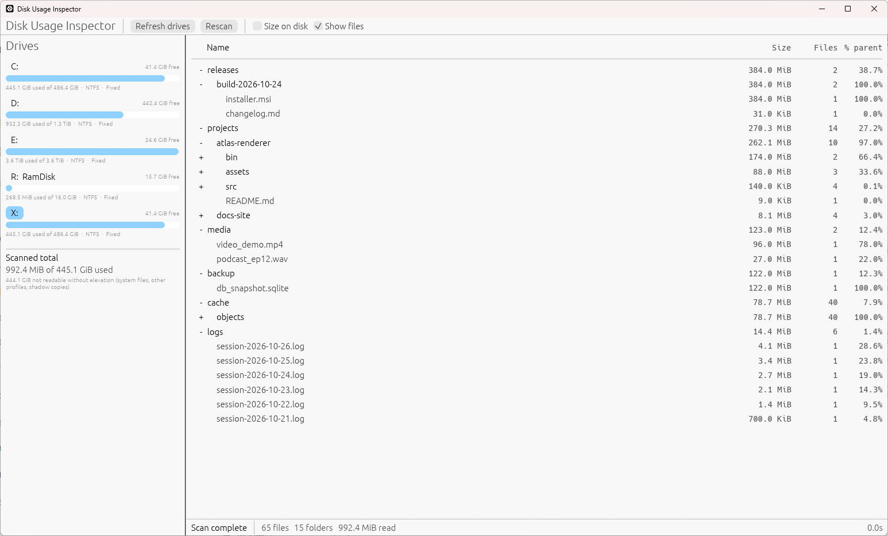

<div align="center">

# Disk Usage Inspector

**A read-only Windows disk explorer that answers one question: what is eating my drive?**

[](https://github.com/DefinitlyEvil/DiskUsageInspector)
[](https://www.rust-lang.org/)
[](https://github.com/emilk/egui)
[](#read-only-by-design)
[](#testing)

<sub>Pick a volume · watch it scan · expand the tree · find the folder that ate your SSD</sub>

</div>

<div align="center">



<sub>Screenshot taken against a synthetic fixture volume — folder sizes, `% parent` and file counts are aggregated live.</sub>

</div>

---

## Why this exists

Windows shows you one number: *free space*. It never shows you **which folder** ate it.
Windows Explorer takes minutes to compute folder sizes (and only one folder at a time),
and the "cleanup" tools out there want to delete things on your behalf.

This tool does the opposite: it **reads metadata, shows you the truth, and touches nothing**.

> **No delete. No move. No rename. No write handles. No elevation. No network.**
> The entire program is a read-only viewer — see [Read-only by design](#read-only-by-design).

---

## Features

| | Feature |
| :---: | :--- |
| 💽 | **Every lettered volume** — label, filesystem, type, total / used / free, plus a usage bar. Empty optical drives and unready media are handled gracefully. |
| 🌲 | **Expandable folder tree** — drill from `C:\` down to any directory; sizes are aggregated over the whole subtree. |
| 📐 | **Two size metrics** — logical bytes by default, optional **size on disk** (compression- and sparse-aware). |
| ⚡ | **Parallel scanner** — a worker pool over `FindFirstFileExW` with `FIND_FIRST_EX_LARGE_FETCH`; ~⅓ million files per second on NVMe. |
| 📈 | **Live totals** — numbers grow while the scan runs (bottom-up aggregation), no blank tree for two minutes. |
| 🧭 | **Virtualized rendering** — only visible rows are drawn, so 100k+ folder trees scroll smoothly. |
| 🛑 | **Cancel anytime** — stops within a directory enumeration (single-digit ms), not at the end of the volume. |
| 🧩 | **Lazy file rows** — the scan keeps folders only; files are enumerated one level at a time when you tick *Show files*. C: costs ~109 MB instead of ~448 MB. |
| 🔗 | **Reparse points are never followed** — junctions/symlinks are shown and counted as links, so nothing is double counted and no cycles. |
| 📁 | **`\\?\` long paths** — verified against a 3 290-character path, 120 levels deep. |
| 🚫 | **Unreadable ≠ fatal** — access-denied entries are counted and badged, the rest of the scan continues. |

---

## How it works

```text
GetLogicalDriveStringsW ──▶ volume list ──▶ you pick a volume
     GetDiskFreeSpaceExW                      │
     GetVolumeInformationW                    ▼
                              worker pool (≤12) over a directory queue
                                          │  one directory at a time
                                          ▼
                              FindFirstFileExW + FindExInfoBasic
                              + FIND_FIRST_EX_LARGE_FETCH
                                          │  name, attributes, size —
                                          │  one syscall per entry
                                          ▼
                                   arena: Vec<Node>
                                   NodeId = u32, no Rc<RefCell>
                                          │
                     bottom-up aggregation (finalize when the last
                     child reports), atomics for progress
                                          │
                                          ▼
                    flattened visible rows ──▶ egui ScrollArea::show_rows
                    (rebuilt at most every 60 ms, only drawn rows)
```

Three details that matter:

- **Arena, not a tree of references.** Every node is an index into one `Vec`; the UI rebuilds a flat row list and draws only what is on screen.
- **Aggregation is bottom-up and incremental.** A directory accumulates its own files immediately and its children's totals as they finish, so sizes are correct the moment the last child completes.
- **The UI never receives per-file events.** Progress is a handful of atomics polled at ~16 Hz.

---

## Performance (measured, warm cache)

| Volume | Time | Files | Folders | Bytes | Peak working set |
| :--- | ---: | ---: | ---: | ---: | ---: |
| `C:` folders only (default) | **6.3 – 6.6 s** | 2.30 M | 500 k | 440.1 GiB | **~109 MB** |
| `C:` with file nodes | 7.2 s | 2.30 M | 500 k | 440.1 GiB | ~448 MB |
| `D:` (data drive) | 23.2 s | 1.2 M | 170 k | 924.3 GiB | ~315 MB |

Throughput ≈ **350–370 k files/s**. Memory is dominated by the GUI framework itself
(~270 MB baseline once the window has rendered); the scan adds only the arena.

---

## Read-only by design

This is not a promise in the README — it is enforced in the code and checked in review:

| Guarantee | How |
| :--- | :--- |
| Never deletes, moves, renames, truncates | no `remove_file`, `remove_dir`, `rename`, `MoveFile`, `DeleteFile`, `SHFileOperation` anywhere in `src/` |
| Never opens a write handle | directory enumeration only; never `GENERIC_WRITE`, `FILE_WRITE_DATA`, `DELETE`, `WRITE_DAC`, `WRITE_OWNER` |
| Never writes to a scanned path | no `File::create`, no `OpenOptions::write`, no attribute changes |
| Never requires admin | a normal user inspects their own files; an unreadable folder is counted, not escalated |
| Never follows links | `FILE_ATTRIBUTE_REPARSE_POINT` entries are reported but not descended into |
| Never phones home | no telemetry, no update check, no network code at all |

`unsafe` exists in exactly one module (`src/platform.rs`), which wraps six Win32
calls, and every block carries a safety comment.

---

## Quick start

**Requirements:** Windows 10/11 and a Rust toolchain (`rustup`, edition 2024 → Rust 1.99+).
Either the MSVC toolchain or the GNU toolchain works; this project was built and
measured with MSYS2 UCRT64 `gcc` — see [AGENTS.md](AGENTS.md) for the exact setup on
this machine.

```powershell
git clone git@github.com:DefinitlyEvil/DiskUsageInspector.git
cd DiskUsageInspector

cargo build --release
.\target\release\disk-usage-inspector.exe
```

The build produces two binaries in `target\release\`:

| Binary | What it is |
| :--- | :--- |
| `disk-usage-inspector.exe` | the GUI (~8 MB, self-contained, no extra runtime DLLs) |
| `duiscan.exe` | a console harness with the same scanner and no GUI — for benchmarking and scripting |

### Benchmark harness

```powershell
# how fast can this machine walk C:? (folders only, top 10 heaviest entries)
.\target\release\duiscan.exe C:\ --no-files --top 10

# include on-disk sizes and per-file nodes, with 8 threads
.\target\release\duiscan.exe D:\ --on-disk --threads 8

# machine-readable-ish summary at the end
.\target\release\duiscan.exe E:\ --no-files
```

It prints elapsed time, file/folder counts, logical (and optional on-disk) bytes,
node count, unreadable count, throughput and the heaviest entries — plus a progress
line every 2 s on stderr, which is how stalls are spotted.

---

## Repository layout

```text
.
├── Cargo.toml              # edition 2024, eframe/egui 0.37, windows-sys 0.61
├── AGENTS.md               # environment, design notes, measured numbers
├── README.md
├── screenshot.png
├── .cargo/config.toml      # pins the build output to ./target
├── src
│   ├── main.rs             # eframe entry point (GUI subsystem in release)
│   ├── app.rs              # panels, drive list, virtualized tree, status bar
│   ├── model.rs            # node arena, aggregation, sorting, lazy file insert
│   ├── scan.rs             # worker pool, cancellation, progress
│   ├── platform.rs         # all Win32 FFI (volumes + directory enumeration)
│   ├── format.rs           # IEC byte formatting
│   └── bin/duiscan.rs      # console benchmark harness
├── tests/scan_smoke.rs     # fixture totals, cancellation, drive enumeration
└── examples/dump.rs        # debug tree printer
```

---

## Testing

```powershell
cargo test                                   # 9 tests: 6 unit + 3 integration
cargo clippy --all-targets -- -D warnings    # must stay clean
cargo fmt --check
```

Unit tests cover the aggregation invariant (a directory finalizes only when it has
enumerated *and* all children reported), path reconstruction, byte formatting, and the
invariant that makes lazy file insertion safe: **adding file children never changes an
aggregate**. Integration tests scan a generated fixture and assert exact totals, honour
cancellation, and verify that volumes can be enumerated.

Fixture checks kept green by hand when the scanner changes:

| Fixture | Expectation |
| :--- | :--- |
| 120 nested directories, 3 290-character path | scanned through `\\?\`, correct bytes |
| junction `link → real` with 1 MiB inside | link counts 0 B, target counted once |
| ACL-denied directory | counted as unreadable, siblings still scanned |
| real `C:` | ~285 unreadable entries reported, scan completes |

---

## FAQ

<details>
<summary><b>Why is the scanned total smaller than the drive's used space?</b></summary>

Because some bytes are invisible to a non-elevated process: `pagefile.sys`, `hiberfil.sys`,
System Volume Information (shadow copies), files locked to `SYSTEM`, other users' profiles,
and everything behind a deny ACL. The app shows this gap explicitly under the drive list as
**Scanned total** — a feature of the domain, not a bug.
</details>

<details>
<summary><b>How are hard links and compressed files counted?</b></summary>

Each *name* is counted once, so a file with N hard links contributes its size N times
(deduplicating requires file IDs — a later optimisation). Compressed and sparse files show
their honest logical size, and the optional **Size on disk** column shows what they actually
cost on the volume.
</details>

<details>
<summary><b>Why do I have to rescan after toggling "Size on disk"?</b></summary>

Allocation sizes cost one extra syscall *per file*, so they are only collected when the
toggle is on before a scan starts. Logical bytes are always collected.
</details>

<details>
<summary><b>Does it need administrator rights?</b></summary>

No — and it never asks for elevation. A few system directories simply stay unreadable and
are counted. An optional NTFS fast path (MFT/USN enumeration, which *would* need admin) is
deliberately not implemented: a full `C:` scan already takes ~6 s.
</details>

<details>
<summary><b>Linux / macOS?</b></summary>

Not supported. The Win32 enumeration layer is the core of the scanner; the model, formatting
and UI are portable, but there is no plan to add other platforms.
</details>

---

## Status & roadmap

**v0.1 — implemented and measured.** Drive list, parallel scanner, tree UI, live progress,
cancel, both size metrics, lazy file rows, long-path and reparse handling.

Open, in rough priority order:

- [ ] Name filter in the tree view
- [ ] Copy-path / reveal context menu polish and keyboard shortcuts
- [ ] 5M-file stress run and a synthetic ACL-denied fixture in CI
- [ ] Optional dark theme, settings persistence (`egui` memory)
- [ ] Decide the distribution form: portable single exe vs installer

Design decisions and their rationale live in [AGENTS.md](AGENTS.md) §8.

---

<div align="center">
<sub>Rust · egui · Win32 · read-only by construction</sub>
</div>
